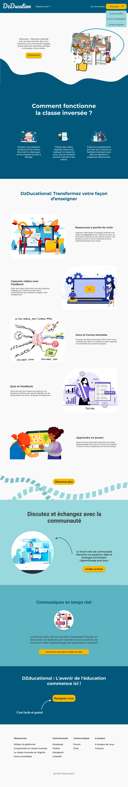
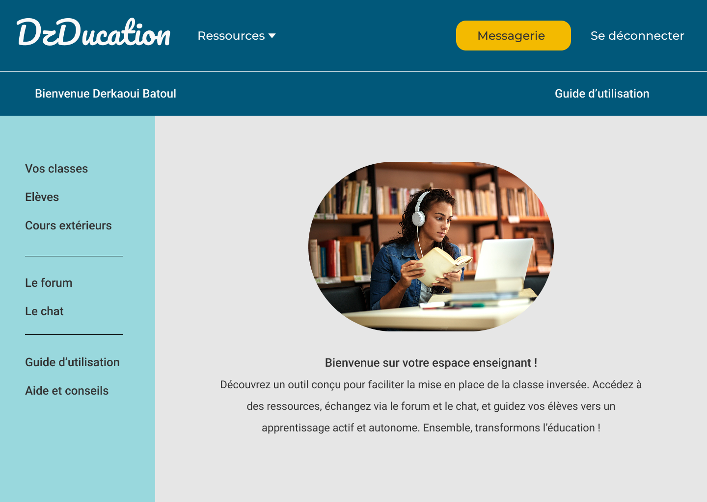

# Flipped Classroom Platform
This is a full-stack educational web platform developed as part of my master's thesis to support the flipped classroom methodology.
The platform provides dedicated functionality for administrators, teachers, and students. Teachers can create and manage classes, publish lessons and educational resources, and create quizzes. Students can access course content, participate in quizzes, and interact with their classes. Administrators can manage users and the overall platform.

## Features
*   **Interactive Courses**: Engaging lessons with videos, quizzes, and tracking.
*   **Instructor Tools**: Course creation and student management system.

## Tech Stack

*   **Frontend**: HTML5, CSS3, JavaScript
*   **Backend**: PHP
*   **Database**: MySQL

## Preview
**Full Website**

**Home Page for Teacher**

